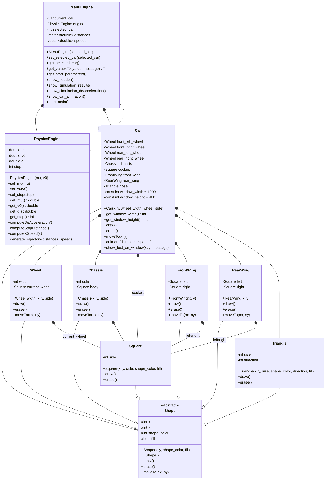

# Simulador de frenado de un vehículo

Cuando un auto sin ABS frena con tanta fuerza que las cuatro ruedas se bloquean, las llantas dejan de rodar y se arrastran sobre el pavimento. Ese derrape es el que deja marcas negras en el asfalto, y con la longitud de esas marcas se puede estimar a qué velocidad iba el vehículo. Reed (1983) lo explica en el capítulo VI de su documento, y ahí el coeficiente de fricción entre la llanta y el camino termina siendo el dato que más cambia los resultados de todo el análisis.

En este mini proyecto se hace el camino contrario. Con la velocidad inicial y el coeficiente de fricción se calcula cuánto desacelera el vehículo, qué distancia necesita para detenerse y qué velocidad lleva cada 10 metros (o cada cuántos metros se configure). Los resultados salen en una tabla en la terminal y en una animación hecha con MiniWin, todo programado en C++ con programación orientada a objetos. El vehículo es una clase compuesta por sus ruedas, su chasis y sus alerones, y los resultados del cálculo se guardan en dos vectores que alimentan tanto la tabla como la animación.

## Contenido

1. [Descripción del problema](#1-descripción-del-problema)
2. [Fundamento técnico](#2-fundamento-técnico)
3. [Limitaciones del modelo](#3-limitaciones-del-modelo)
4. [Diseño de la solución orientada a objetos](#4-diseño-de-la-solución-orientada-a-objetos)
5. [Descripción del programa](#5-descripción-del-programa)
6. [Justificación de la solución](#6-justificación-de-la-solución)
7. [Conclusión](#7-conclusión)
8. [Referencias](#8-referencias)

---

## 1. Descripción del problema

### Fenómeno que se simula

El programa simula el frenado de un automóvil que no tiene ABS ni ningún otro sistema de asistencia. Cuando la fuerza de frenado es lo bastante alta, las cuatro ruedas se bloquean y las llantas se arrastran sobre el pavimento. A partir de ese momento lo único que frena al vehículo es la fricción entre la llanta y el camino, y el auto sigue avanzando mientras esa fuerza le va quitando velocidad hasta que se detiene.

Es el mismo escenario que Reed (1983) analiza en el capítulo VI. En su documento, la longitud de las marcas de derrape, el coeficiente de fricción y la velocidad al momento del impacto sirven para estimar a qué velocidad iba un vehículo antes de frenar (p. 120). Aquí el simulador va al revés: primero se ingresa la velocidad, el coeficiente de fricción y cada cuántos metros se quiere hacer el cálculo, y con eso el programa entrega la desaceleración, la distancia total de frenado, la velocidad en cada punto del recorrido y una animación del frenado.

### Suposiciones

- Las cuatro ruedas permanecen bloqueadas durante todo el frenado, desde el primer metro hasta la detención.
- La superficie es horizontal, sin pendiente.
- El coeficiente dinámico de fricción μ es constante a lo largo del recorrido y es el mismo para las cuatro llantas.
- La fuerza normal total es igual al peso del vehículo, N = w = mg. Reed (1983, p. 123) usa esta misma igualdad para simplificar el análisis.
- Toda la energía cinética inicial se disipa entre la llanta y el camino (Reed, 1983, p. 122). Esto significa que no se consideran la resistencia del aire ni la de rodamiento.
- El vehículo se trata como una partícula que avanza en línea recta, sin giros ni cabeceo.
- La aceleración de la gravedad vale g = 9.81 m/s².

Con estas suposiciones la desaceleración resulta constante, y eso es lo que permite usar las ecuaciones del movimiento uniformemente acelerado.

### Variables

| Variable | Descripción | Unidad | Tipo |
|---|---|---|---|
| μ | Coeficiente dinámico de fricción entre las llantas y el camino | Adimensional | Entrada |
| v₀ | Velocidad al inicio del derrape (se captura en km/h y se convierte a m/s) | km/h y m/s | Entrada |
| Δx | Paso de la simulación, es decir, cada cuántos metros se calcula una velocidad (10 m por defecto) | m | Entrada |
| m | Masa del vehículo. Aparece al plantear las fuerzas, pero se cancela, así que el simulador no la usa | kg | No se usa |
| w, N, F | Peso, fuerza normal sobre las cuatro llantas y fuerza de fricción | N | Intermedia |
| g | Aceleración de la gravedad | m/s² | Constante |
| a | Magnitud de la desaceleración | m/s² | Resultado |
| s | Distancia total de frenado | m | Resultado |
| x | Distancia recorrida desde el inicio del frenado | m | Intermedia |
| vₓ | Velocidad después de recorrer la distancia x | m/s y km/h | Resultado |
| n | Número de puntos que se calculan, n = ⌊s/Δx⌋ | Adimensional | Intermedia |

---

## 2. Fundamento técnico

### Desaceleración

Con las ruedas bloqueadas, la fuerza que se opone al movimiento es la fricción dinámica. Esta es proporcional a la fuerza normal, y sobre una superficie horizontal la fuerza normal de las cuatro llantas es igual al peso:

$$F = \mu N = \mu w = \mu m g \tag{1}$$

Por la segunda ley de Newton, esa misma fuerza produce una desaceleración sobre la masa del vehículo:

$$F = m a \tag{2}$$

Al igualar (1) y (2), la masa se cancela:

$$m a = \mu m g \quad \Rightarrow \quad a = \mu g \tag{3}$$

Esto quiere decir que la desaceleración depende de la superficie y no del vehículo. Reed (1983, p. 123) lo explica así: como μ es proporcional a la desaceleración por un factor g, la desaceleración es constante durante todo el derrape.

### Distancia de frenado

En el documento la distancia se obtiene con el teorema del trabajo y la energía (1983, p. 122). La energía cinética del vehículo y el trabajo que hace la fricción sobre las llantas son:

$$E_c = \frac{1}{2} m V^2 \tag{4}$$

$$W = F s \tag{5}$$

Para detener el vehículo, el trabajo tiene que igualar a la energía cinética inicial. Sustituyendo F con la ecuación (1):

$$\mu m g s = \frac{1}{2} m V^2 \tag{6}$$

Se cancela la masa y se despeja s:

$$s = \frac{V^2}{2 \mu g} \tag{7}$$

Esta ecuación dice cuál será la distancia total de frenado una vez que se bloquean las llantas. En la investigación de referencia se despeja V para saber la velocidad original del auto a partir de las marcas. En este proyecto es al revés: el usuario introduce la velocidad y con la ecuación (7) se calcula la distancia.

### Velocidad en cada punto del recorrido

Como la desaceleración es constante, la cinemática del movimiento uniformemente acelerado relaciona la velocidad con la distancia. Con aceleración a = −μg:

$$v^2 = v_0^2 + 2(-\mu g)x \tag{8}$$

$$v_x = \sqrt{v_0^2 - 2 \mu g x} \tag{9}$$

La ecuación (9) es la que usa el programa en cada punto. Todos los cálculos se hacen en m/s y el resultado se convierte a km/h al final:

$$v\,(\text{km/h}) = v\,(\text{m/s}) \times 3.6 \tag{10}$$

La ecuación (9) también confirma la distancia: si vₓ = 0, entonces x = v₀² / (2μg), que es justo la ecuación (7). Es decir, la distancia total de frenado es el punto donde la velocidad llega a cero.

Con un paso Δx, los puntos de la simulación son xᵢ = i · Δx, con i = 0, 1, 2, …, n y n = ⌊s/Δx⌋. El programa evalúa la ecuación (9) en cada xᵢ y guarda el par (xᵢ, vᵢ) en los vectores. El paso importa sobre todo en la simulación gráfica: con un paso pequeño el movimiento del vehículo se ve más fluido, y con uno muy grande da "saltos".

### Ejemplo: 130 km/h y μ = 0.5

- Velocidad en m/s: v₀ = 130 / 3.6 = 36.11 m/s.
- Desaceleración: a = 0.5 × 9.81 = 4.905 m/s².
- Distancia de frenado: s = 36.11² / (2 × 0.5 × 9.81) = 132.93 m.
- Velocidad a 10 m: vₓ = √(1304.01 − 2 × 0.5 × 9.81 × 10) = 34.73 m/s, que son 125.01 km/h.

### Referencia de las ecuaciones

Las ecuaciones (1) a (7) siguen el desarrollo de Reed (1983, pp. 120 a 123), ecuaciones (6-1) y (6-3) a (6-9), donde se muestra paso a paso cómo se llega a la distancia. Las ecuaciones (8) y (9) son la cinemática de aceleración constante aplicada a la desaceleración de la ecuación (3), y el documento respalda esto cuando explica que una desaceleración constante implica una disminución lineal de la velocidad (p. 123). La conversión de unidades de la ecuación (10) es directa.

---

## 3. Limitaciones del modelo

El modelo es una aproximación, y la lectura de Reed ayuda a ver en qué se separa de un vehículo real.

### Un solo coeficiente de fricción promedio

En el documento, el μ de la ecuación (6-1) es un promedio sobre todo el rango de velocidades, desde la velocidad inicial hasta cero. Esto significa que μ no cambia con el tiempo, ni con la distancia, ni con la velocidad (1983, pp. 121 y 123). No es lo que pasa en la realidad, pero simplifica mucho los cálculos.

Un μ constante produce una desaceleración constante y un descenso perfectamente regular de la velocidad. En un frenado real la fricción puede variar durante el derrape, por ejemplo porque la llanta se calienta o porque la superficie cambia de un tramo a otro. Esto afecta sobre todo a las velocidades intermedias de la tabla.

### Sensibilidad a μ

Reed menciona que los errores al especificar μ son la fuente de error más seria de su proceso, y que sin una medición precisa de μ se pierde buena parte del cuidado puesto en el resto del análisis (1983, p. 119).

Un ejemplo con v₀ = 130 km/h: si μ cambia de 0.50 a 0.45, la distancia de frenado sube de 132.93 m a 147.70 m, y si cambia a 0.55 baja a 120.84 m. Una variación de ±0.05 en μ mueve la distancia entre 12 y 15 m, y todo depende de un solo valor que el programa no puede confirmar. El resultado depende por completo de lo que ingrese el usuario.

### Sensibilidad a la velocidad inicial

Reed dice que la velocidad previa al derrape es difícil de obtener con la exactitud necesaria y que, como aparece al cuadrado, su error se amplifica (1983, p. 121). En el modelo se ve en la ecuación (7): un error de 5 % en v₀ produce un error de aproximadamente 10 % en s.

Con el mismo ejemplo de 130 km/h y μ = 0.5, una velocidad de 136.5 km/h daría una distancia de 146.55 m en lugar de 132.93 m.

### El inicio del derrape

El modelo supone que las ruedas se bloquean en el instante en que empieza el frenado y que la distancia se mide desde ese punto. Reed explica que en la práctica las marcas pueden no aparecer hasta que el vehículo ya se deslizó varios pies, y que incluso entonces su inicio es difícil de ubicar (1983, p. 121). En un caso real hay una fase previa, entre la reacción y el bloqueo, que el simulador no incluye.

### Toda la energía se disipa en la llanta

La ecuación (6) parte de que toda la energía cinética se transforma por la fuerza entre las llantas y el camino, y que la mayor parte se convierte en calor (Reed, 1983, p. 122). El modelo no incluye otras fuerzas que sí actúan sobre un auto real, como la resistencia del aire, la resistencia al rodamiento o el freno motor. A velocidades altas, como los 130 km/h, la resistencia del aire ayuda a frenar al inicio y el modelo la ignora, así que la distancia de frenado calculada tiende a ser mayor que la real.

### Fuerza normal igual al peso y movimiento de partícula

Reed supone que la fuerza normal combinada de todas las llantas es igual al peso total (1983, p. 123). Eso implica que las cuatro llantas aportan la misma fricción y que el peso se reparte igual durante todo el frenado. En un auto real, al frenar el peso se transfiere hacia las ruedas delanteras y la fricción disponible en cada eje no es la misma. Este punto no se menciona en el documento, pero sale directo de la suposición N = mg. Tampoco se contempla el caso de trayectorias curvas, en las que la dirección del auto cambie durante el derrape.

### Alcance de la animación

La animación es una representación proporcional. El tamaño del auto en pantalla y la distancia recorrida en la ventana no están a escala real. Lo único que se hace para representar mejor el frenado es mantener una proporción entre cada punto calculado y el tiempo que tarda el carrito en avanzar: entre más avanza, más tarda en cambiar de posición, como pasaría con un auto real. Aun así, los metros de la pantalla y el tamaño del carro están limitados por lo que MiniWin puede mostrar.

---

## 4. Diseño de la solución orientada a objetos

### Clases utilizadas y responsabilidad de cada una

- `PhysicsEngine`: guarda los parámetros físicos (μ, v₀, g y el paso) y calcula la desaceleración, la distancia de frenado y la velocidad en cualquier punto. Sus métodos son `computeDeAcceleration()`, `computeStopDistance()`, `computeXSpeed(x)` y `generateTrajectory()`.
- `MenuEngine`: controla la interacción con el usuario. Pide los datos, llama a `PhysicsEngine`, guarda los resultados en los vectores y los muestra en pantalla. También lanza la animación después de usar la terminal.
- `Car`: representa el vehículo y coordina su animación. Dibuja el auto, lo mueve a una posición y reproduce el desplazamiento completo. Esta es la clase solicitada como Vehículo, y se relaciona con el resto a través de los vectores `distances` y `speeds`, que dan los puntos para la animación en la función `animate()`.
- `Shape`: clase abstracta base de los objetos gráficos, con los métodos `draw()`, `erase()` y `moveTo()`.
- `Wheel`, `Square` y `Triangle`: componentes gráficos básicos con los que se construye el auto. Heredan de `Shape` para no repetir métodos.
- `Chassis`: módulo que dibuja y mueve el chasis.
- `FrontWing` y `RearWing`: módulos que agrupan las dos piezas de cada alerón y las mueven juntas.
- `miniwin`: biblioteca externa que abre la ventana y dibuja la animación.

### Relación de composición

La clase `Car` está compuesta por cuatro objetos `Wheel`, un `Chassis`, un `FrontWing`, un `RearWing`, y objetos `Square` y `Triangle` para la cabina y la punta del auto. Es composición porque el auto contiene directamente todos sus componentes: si el objeto `Car` deja de existir, las demás piezas también desaparecen. Además, los componentes no tienen sentido por separado, ni siquiera podrían aparecer en pantalla sin el auto.

La idea es la misma de un carro real, que tiene ruedas, chasis y alerones, y se intentó reflejar el armado de un carro de F1 en el código. Cada módulo controla por su cuenta su posición y demás atributos con las funciones heredadas de la clase abstracta `Shape`, y el trabajo de `Car` es solo coordinarlos para que funcionen como si fueran un solo objeto. Esto se ve en `car.h`, `chassis.h`, `front_wing.h` y `rear_wing.h`, donde cada clase tiene sus propios métodos y nombres para las piezas que la forman.

También hay composición a nivel de control: `MenuEngine` contiene un `PhysicsEngine` y un `Car`. El menú es dueño del motor de cálculo y del vehículo que se anima. Sin el menú las demás clases podrían funcionar, pero no tendrían sentido dentro del programa, porque es el menú el que interactúa con el usuario. En general, el menú ordena las tareas y las demás clases las ejecutan.

### Uso de los vectores

`MenuEngine` usa dos vectores paralelos:

```cpp
std::vector<double> distances;
std::vector<double> speeds;
```

La posición `i` de ambos vectores es un punto de la simulación: `distances[i]` guarda la distancia recorrida y `speeds[i]` la velocidad en esa distancia.

```text
distances[i] <-> speeds[i]
```

Los vectores se llenan una sola vez con `generateTrajectory()` y después se leen en dos lugares. Primero para imprimir la tabla de resultados con el espacio necesario, y luego para controlar la animación, donde cada par consecutivo define cuánto avanza el carro y con qué retraso. Así, tanto el movimiento como los resultados dependen de los mismos datos.

Los vectores son atributos de `MenuEngine`, en el archivo `1_menu_engine.h`. Se declaran ahí para que cualquier clase dentro de la composición del menú pueda usarlos, como cuando se llaman para calcular la trayectoria en `show_simulation_results()`.

### Diagrama de clases



*Figura 1. Diagrama de clases del simulador.*

Para leer el diagrama:

- Todas las figuras (`Car`, `Wheel`, `Square`, `Triangle`, `Chassis`, `FrontWing` y `RearWing`) heredan de `Shape`, por eso comparten las coordenadas, el color, el relleno y `moveTo()`. `Shape` es abstracta porque obliga a cada figura a implementar `draw()` y `erase()`.
- `MenuEngine` contiene un `Car` y un `PhysicsEngine`, y además guarda `selected_car`, `distances` y `speeds`.
- `Car` contiene sus cuatro ruedas, el chasis, la cabina, los dos alerones y el morro. Todos se crean y se destruyen junto con el auto.
- Cada módulo guarda las figuras simples que necesita: `Wheel` y `Chassis` un cuadrado, `FrontWing` y `RearWing` dos (`left` y `right`). Cuando el módulo se mueve, mueve también lo que contiene.
- `PhysicsEngine` es una dependencia y no una composición. `generateTrajectory()` recibe los vectores de `MenuEngine` por referencia para llenarlos, pero no los guarda ni es su dueño.
- `miniwin` no aparece como clase porque es una biblioteca de apoyo para dibujar, borrar y mostrar texto, y no forma parte de la composición del auto.

---

## 5. Descripción del programa

### Funcionamiento general

1. Se crea un objeto `MenuEngine` que llama a las demás funciones y clases.
2. El usuario introduce μ, v₀ y el paso de la simulación. Si el valor no es positivo, el programa usa uno por defecto.
3. `PhysicsEngine` calcula la desaceleración con la ecuación (3).
4. Se genera la trayectoria de frenado con las ecuaciones (7) y (9), y los resultados se guardan en los vectores `distances` y `speeds`.
5. Se imprime una tabla con distancia y velocidad, tomada de los vectores.
6. Se abre una ventana de MiniWin. Al ejecutar desde VS Code la ventana se abre desde el inicio, pero no se puede interactuar con ella porque todavía no tiene instrucciones ni gráficos.
7. El carro de F1 se desplaza proporcionalmente a la distancia calculada.
8. El retraso de la animación depende de la velocidad promedio de cada segmento. En la función `Car::animate()` se calcula un delay específico para cada punto, de forma que el auto avanza más rápido al inicio y más lento al final, como pasaría en la vida real. El paso influye aquí: con un paso pequeño el movimiento se ve más fluido, y con uno grande el auto aparece y desaparece en intervalos que se van haciendo más largos. Esta característica es extra, pero permite mostrar mejor cómo es el frenado real, en lugar de un movimiento a velocidad constante.

### Instrucciones de uso

El archivo de entrada es `0_main_app.cpp`, donde se llama al menú, y se nombra con 0 para que aparezca arriba en la lista de archivos. Se puede ejecutar el compilado `0_main_app.exe`, o desde VS Code presionar F5 (o compilar el `.cpp`), con lo que se genera el `.exe` que sigue estos pasos:

1. Introducir un valor positivo para μ. Si el valor no es válido, se muestra un mensaje de error y se usa uno por defecto.
2. Introducir la velocidad inicial en km/h. También tiene valor por defecto con mensaje de error.
3. Introducir el paso de la simulación (10 m por defecto). Es una característica extra, pero le da más sentido al simulador porque permite ver cómo cambia el movimiento.
4. Se muestran la distancia total y la desaceleración calculadas.
5. Se muestra en la terminal la tabla de velocidad y distancia recorrida.
6. Presionar ENTER para abrir la animación en MiniWin. Esta instrucción aparece al final de la tabla, así que con pasos pequeños puede ser necesario hacer scroll para verla.
7. Se muestra la animación, donde el vehículo se detiene poco a poco según el valor del paso.
8. Presionar R para repetirla, o cualquier otra tecla para cerrarla.

### Resultados de las pruebas

Caso de validación: v₀ = 130 km/h, μ = 0.5 y paso de 10 m.

- Desaceleración esperada: a = −4.905 m/s². El programa muestra −4.905 m/s², y el signo negativo indica que el vehículo desacelera.
- Distancia de frenado esperada: s = 132.93 m. Con el redondeo de decimales, el programa muestra s = 132.9268 m.

La tabla compara los valores de la guía del proyecto con los que calcula y redondea el programa:

| X (m) | V guía (km/h) | V programa (km/h) | Dif. (programa − guía) |
|---:|---:|---:|---:|
| 10 | 125.0144952 | 125.0145 | +0.0000048 |
| 20 | 119.8217343 | 119.8217 | −0.0000343 |
| 30 | 114.3934963 | 114.3935 | +0.0000037 |
| 40 | 108.6945077 | 108.6945 | −0.0000077 |
| 50 | 102.6796961 | 102.6797 | +0.0000039 |
| 60 | 96.28989563 | 96.2899 | +0.0000044 |
| 70 | 89.44477626 | 89.4448 | +0.0000237 |
| 80 | 82.03043338 | 82.0304 | −0.0000334 |
| 90 | 73.87567935 | 73.8757 | +0.0000206 |
| 100 | 64.70115919 | 64.7012 | +0.0000408 |
| 110 | 53.98948046 | 53.9895 | +0.0000195 |
| 120 | 40.5399556 | 40.5400 | +0.0000444 |
| 130 | 19.29020477 | 19.2902 | −0.0000048 |

Son prácticamente los mismos valores que pide la guía. La diferencia más grande es de unos 4.4 × 10⁻⁵ km/h, y viene de que la consola imprime solo 4 decimales. La tabla llega hasta 130 m porque el siguiente punto, 140 m, ya pasa de los 132.93 m de frenado. Aun así, el programa siempre agrega un último punto con la distancia total y velocidad cero, para mostrar dónde se detiene el carro. Es otra característica extra y se ve en la captura 2.

---

## 6. Justificación de la solución

### Relación entre el modelo físico y la implementación

Cada ecuación de la sección 2 tiene un método que la implementa:

- `computeDeAcceleration()` calcula a = μg (ecuación 3).
- `computeStopDistance()` calcula s = v₀² / (2μg) (ecuación 7), con v₀ ya en m/s.
- `computeXSpeed(x)` calcula vₓ = √(v₀² − 2μgx) (ecuación 9) y devuelve el resultado en km/h (ecuación 10).
- `generateTrajectory()` recorre las distancias x = 0, Δx, 2Δx, … hasta s, llama a `computeXSpeed(x)` en cada una y guarda los resultados en los vectores.

Para evitar problemas con la raíz, la misma función se asegura de que el argumento nunca sea negativo (líneas 74 a 76 de `2_1_physics_engine.cpp`). Así siempre se obtiene una velocidad válida y se evitan errores cerca del final del frenado.

### Evidencia de que los cálculos son correctos

La evidencia tiene tres partes. Primera, la desaceleración y la distancia del caso de validación coinciden con lo esperado: −4.905 m/s² y 132.93 m. Segunda, las 13 velocidades de la tabla coinciden con las de la guía, y las diferencias son tan pequeñas que vienen del redondeo de decimales, así que en realidad son el mismo valor.

Tercera, el modelo es coherente consigo mismo. Si se evalúa la ecuación (9) en x = s, la velocidad es cero, que es justo la definición de la distancia de frenado. Además, el resultado coincide con el método de la energía de Reed (ecuaciones 6-3 a 6-9), que llega a la ecuación (7) por otro camino. Los dos métodos dan lo mismo y el programa lo confirma en la captura 2, por lo que los cálculos son correctos de acuerdo con las ecuaciones desarrolladas.

### Decisiones principales de diseño

Al empezar se consideraron dos propuestas:

- **A.** Una súper clase `Car` con el `PhysicsEngine` y el `MenuEngine` dentro, para llamar a un solo objeto y que, en caso de replicarse, cada carro tuviera su propio motor.
- **B.** Tres clases independientes para el menú, la calculadora y el objeto gráfico, con composición entre sí: el menú crea el `PhysicsEngine`, hace los cálculos y después llama al objeto gráfico para ejecutar la simulación.

Mientras avanzaba el desarrollo se decidió que la mejor opción era la B. Primero, la física no cambia de un carro a otro, porque las mismas ecuaciones describen cada caso. Segundo, al ser independiente el objeto gráfico de la calculadora, se pudo probar el funcionamiento solo en la terminal, sin problemas de MiniWin, y atacar un problema a la vez. La opción B significa más archivos y más código, pero tener tres clases separadas ayuda a depurar errores, probar módulos por separado y dejar más claros los atributos y las llamadas a funciones.

Esta fue la decisión más importante, y de ahí salen las siguientes:

- **Separar el cálculo de la interfaz.** `PhysicsEngine` solo hace física y no sabe nada de la consola ni de la ventana, y `MenuEngine` solo maneja la interacción. Esto permitió probar la física con la tabla de la guía sin abrir la animación, y fue muy útil al inicio, cuando se quería comprobar las ecuaciones sin que MiniWin diera problemas adicionales.
- **Vectores en el menú.** Los vectores pertenecen a `MenuEngine` para que puedan accederse desde la calculadora y desde el auto. Como son paralelos y del mismo tamaño, ni la tabla ni el cálculo de puntos de la animación tienen que verificar que coincidan. Una posible mejora es usar un vector bidimensional, de forma que si falta algún dato en una línea los espacios se llenen con 0 (solo pasaría si el programa falla).
- **`Car` como composición de módulos.** `Wheel`, `Chassis`, `FrontWing` y `RearWing` tienen sus propias funciones. En lugar de dibujar todo en una sola clase, se puede modificar una sección sin afectar al auto completo.
- **Clase abstracta `Shape`.** Con herencia y métodos virtuales no hace falta repetir atributos ni funciones, y cada figura solo implementa `draw()`, `erase()` y `moveTo()` según lo necesite. El código se redujo, las clases de figuras y de composición solo llaman a dibujar o borrar sin controles adicionales, y se terminó el código fuente en menos tiempo del esperado con una clase `Car` más limpia. Es otra de las decisiones más relevantes.
- **Delay variable en la animación.** Se hizo un cálculo extra para que el retraso entre cada llamada a `moveTo()` sea proporcional a la distancia del punto, de modo que el auto se mueva más lento al final, como en un frenado real. Se usó el método `espera()` de MiniWin, que facilita el trabajo sin recurrir a funciones de tiempo complejas.
- **VS Code en lugar de Embarcadero Dev C++.** Fue por facilidad de uso y hábito de programación, y también por el ecosistema que ya tenía armado de proyectos anteriores, con herramientas como git para el control de versiones.

### Análisis de los resultados

Lo más visible de la tabla es que la velocidad no baja de forma uniforme respecto a la distancia. En los primeros 10 m el auto pierde un poco menos de 5 km/h (de 130 a 125.01), mientras que entre los 120 y los 130 m pierde más de 21 km/h (de 40.54 a 19.29). Esto se debe a la raíz cuadrada de la ecuación (9): la desaceleración es constante en el tiempo, pero medida en distancia la velocidad cae cada vez más rápido hacia el final. En el tiempo sí es lineal, como indica el documento de Reed (1983, p. 123), y el auto del caso de validación tarda unos 7.36 s en detenerse (v₀ / a = 36.11 / 4.905).

La distancia de frenado crece con el cuadrado de la velocidad inicial. Duplicar la velocidad cuadruplica la distancia, y por eso a 130 km/h se necesitan 132.93 m mientras que a 65 km/h bastan 33.23 m (calculado a mano). También crece cuando baja μ: con μ = 0.3 y 80 km/h el auto necesita 83.90 m, unos 33.6 m más que los 50.34 m que necesitaría a esa misma velocidad con μ = 0.5, es decir, alrededor de 67 % más.

En la realidad, el modelo es más confiable cuando μ es conocido y estable, y menos cuando el pavimento o la llanta cambian durante el derrape (por ejemplo, con lluvia), como se describió en la sección 3.

## 7. Referencias

- Reed, W. S. (1983). *Automobile Accident Reconstruction by Dynamic Simulation*. University of Texas at Austin, Center for Transportation Research. https://rosap.ntl.bts.gov/view/dot/77996
- Mermaid Editor. (s. f.). *Free Online Mermaid Editor: Flowcharts, Sequence Diagrams & More*. Recuperado el 30 de octubre de 2026 de https://www.mermaideditor.io/