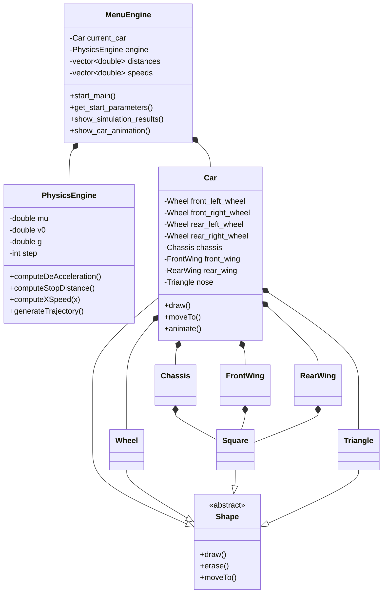

# Brake Simulator

## 1. Descripción del problema

El simulador es sobre la desaceleración de un vehículo que frena sobre una superficie horizontal.

El usuario proporciona:

- Coeficiente de fricción `μ`.
- Velocidad inicial `v₀` en km/h.
- Paso de simulación en metros.

El programa calcula la desaceleración, la distancia necesaria para detener el vehículo y la velocidad en diferentes posiciones del recorrido. Finalmente, muestra una animación mediante MiniWin.

### Suposiciones

- El vehículo se mueve en línea recta.
- El coeficiente de fricción es constante.
- La superficie es horizontal.
- La aceleración es constante.
- No se consideran resistencia del aire, pendiente, suspensión, transferencia de peso ni tiempo de reacción.
- La masa del vehículo se cancela porque la fuerza de fricción es `F = μmg`.

### Variables

| Variable | Descripción | Unidad |
|---|---|---|
| `μ` | Coeficiente de fricción | Adimensional |
| `g` | Aceleración gravitacional | m/s² |
| `v₀` | Velocidad inicial | m/s |
| `v` | Velocidad durante el recorrido | m/s |
| `x` | Distancia recorrida | m |
| `a` | Desaceleración | m/s² |
| `d` | Distancia total de frenado | m |

## 2. Fundamento técnico

La fuerza normal sobre una superficie horizontal es:

```text
N = mg
```

La fuerza de fricción cinética es:

```text
Ff = μN = μmg
```

Aplicando la segunda ley de Newton:

```text
F = ma
```

se obtiene:

```text
ma = -μmg
a = -μg
```

El signo negativo indica que la aceleración se opone al movimiento.

En el programa, esta ecuación se implementa en `computeDeAcceleration()` dentro de
`2_1_physics_engine.cpp`.

La velocidad en función de la distancia se calcula mediante:

```text
v² = v₀² + 2ax
```

Por lo tanto:

```text
v = √(v₀² + 2ax)
```

La distancia de frenado se obtiene cuando `v = 0`:

```text
0 = v₀² + 2ad
d = -v₀² / (2a)
```

El programa usa el valor absoluto para garantizar una distancia positiva.

La velocidad introducida en km/h se convierte a m/s mediante:

```text
v₀(m/s) = v₀(km/h) / 3.6
```

La velocidad mostrada en la tabla vuelve a convertirse a km/h.

## 3. Limitaciones del modelo

El modelo es una aproximación ideal. Un vehículo real presenta diferencias importantes:

- El coeficiente de fricción no es constante.
- El pavimento puede estar húmedo, irregular o contaminado.
- Existe resistencia aerodinámica.
- La masa se transfiere hacia el eje delantero durante el frenado.
- Los neumáticos pueden deslizarse o activar el sistema ABS.
- El sistema de frenos tiene un tiempo de respuesta.
- El conductor tiene un tiempo de reacción.
- La pendiente modifica la fuerza normal y la desaceleración.
- La velocidad real no disminuye perfectamente de forma uniforme.
- La suspensión, los neumáticos y el estado del vehículo afectan el resultado.

Por estas razones, los resultados representan un escenario ideal y no deben utilizarse como predicción exacta del comportamiento de un vehículo real.

## 4. Diseño orientado a objetos

### Clases principales

- `PhysicsEngine`: almacena los parámetros físicos y calcula la desaceleración, la distancia de frenado y las velocidades.
- `MenuEngine`: controla la interacción con el usuario, solicita datos y muestra los resultados.
- `Car`: representa el vehículo y controla su animación mediante módulos.
- `Shape`: clase abstracta base para los objetos gráficos.
- `Wheel`, `Square` y `Triangle`: componentes gráficos utilizados para construir el automóvil.
- `Chassis`: módulo que representa y mueve el chasis del automóvil.
- `FrontWing`: módulo que agrupa las dos piezas del alerón delantero.
- `RearWing`: módulo que agrupa las dos piezas del alerón trasero.
- `miniwin`: biblioteca utilizada para abrir la ventana y dibujar la animación.

### Composición

La clase `Car` está compuesta por:

- Cuatro objetos `Wheel`.
- Un objeto `Chassis`.
- Un objeto `FrontWing`.
- Un objeto `RearWing`.
- Objetos `Square` y `Triangle` para la cabina y el morro.

Esto significa que el automóvil contiene directamente sus componentes gráficos. Si el objeto `Car` deja de existir, sus ruedas y piezas también dejan de existir.

Cada módulo encapsula las primitivas que necesita para dibujarse y moverse. Por ejemplo, `FrontWing` y `RearWing` controlan internamente sus dos piezas laterales; `Car` solo coordina módulos completos. La composición se observa en `car.h`, `chassis.h`, `front_wing.h` y `rear_wing.h`.

### Uso de vectores

`MenuEngine` utiliza dos vectores:

```cpp
std::vector<double> distances;
std::vector<double> speeds;
```

Cada posición de ambos vectores representa un punto de la simulación:

```text
distances[i] <-> speeds[i]
```

El vector `distances` contiene las posiciones recorridas y `speeds` contiene la velocidad correspondiente en cada posición.

### Diagrama de clases



## 5. Descripción del programa

El funcionamiento general es:

1. Se crea un objeto `MenuEngine`.
2. El usuario introduce `μ`, `v₀` y el paso.
3. `PhysicsEngine` calcula la desaceleración.
4. Se genera la trayectoria de frenado.
5. Se imprime una tabla con distancia y velocidad.
6. Se abre una ventana MiniWin.
7. El automóvil se desplaza proporcionalmente a la distancia calculada.
8. El retraso de la animación depende de la velocidad promedio de cada segmento.

### Ejecución

También puede ejecutarse el archivo compilado:

`0_main_app.exe`

Durante la ejecución:

1. Introducir un valor positivo para `μ`.
2. Introducir la velocidad inicial en km/h.
3. Introducir el paso de simulación.
4. Presionar `ENTER` para abrir la animación.
5. Presionar `R` para repetirla o cualquier otra tecla para cerrarla.
